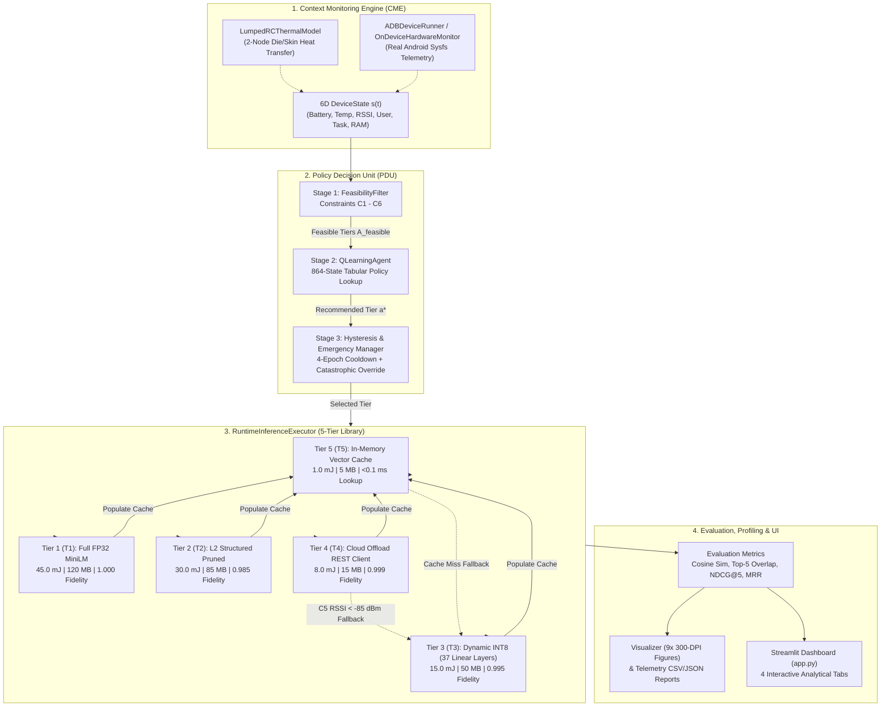
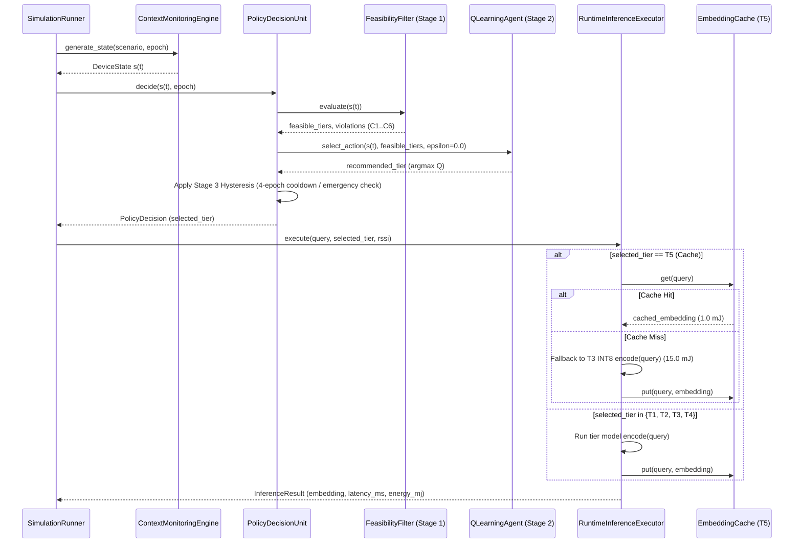
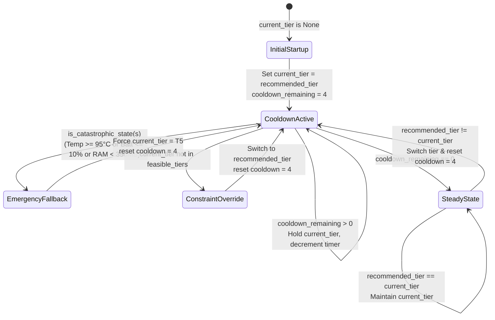

# AdaptGreen: Comprehensive Project & Technical Report

> **"AdaptGreen: A Context-Adaptive Runtime Framework for Energy-Efficient Mobile AI Inference"**  
> *ICCA 2026 Research Simulation Prototype, Live Runtime Engine, Hardware Profiler, and Interactive Evaluation Suite*

---

## 1. Executive Summary & Project Overview

**AdaptGreen** is an energy-aware, context-adaptive runtime framework designed to optimize deep learning inference on resource-constrained mobile and edge devices. Rather than executing a static, full-precision neural network regardless of device operating conditions, AdaptGreen continuously monitors a 6-dimensional hardware and operational context state vector and dynamically dispatches workloads across a **5-tier inference execution hierarchy (`T1`–`T5`)**.

### Core Objectives
1. **Energy Conservation**: Minimize battery drain during low-battery, background sync, or high-strain operational states (achieving **97.78%** energy savings in `BACKGROUND_BATCH` and **75.48%** in `BATTERY_CRITICAL` compared to static FP32 execution).
2. **Thermal Stability**: Prevent System-on-Chip (SoC) thermal runaway and frequency throttling by restricting compute-intensive neural tiers when temperatures cross hardware safety thresholds ($80.0^\circ\text{C}$) and enforcing a **4-epoch hysteresis cooldown** to eliminate rapid tier oscillation ("ping-ponging").
3. **Semantic Quality & Low Latency**: Preserve 384-dimensional neural representation fidelity (`sentence-transformers/all-MiniLM-L6-v2`) and downstream Top-5 academic paper recommendation accuracy when resources are abundant and the user is actively interacting in the foreground.

> [!NOTE]
> **Simulation vs. Real Execution Scope**: In this prototype ([README.md](file:///c:/Users/irfan/Desktop/Green/New%20folder/AdaptGreen/README.md#L264-L289)), environmental trajectories (battery depletion, SoC temperature curves, RAM pressure, RSSI fluctuations) and per-tier energy values ($45/30/15/8/1\text{ mJ}$) are deterministically simulated for reproducible benchmarking, while **all neural inference passes (`T1` FP32, `T2` L2-Pruned, `T3` Dynamic INT8), `T5` vector caching, wall-clock latency measurements, PDU constraint filtering, offline Q-table lookups, and downstream retrieval metrics run as real software**. Additionally, the repository includes live host CPU profiling ([hardware_profiler.py](file:///c:/Users/irfan/Desktop/Green/New%20folder/AdaptGreen/adaptgreen/runtime/hardware_profiler.py)) and physical Android hardware bridges via ADB ([adb_device_runner.py](file:///c:/Users/irfan/Desktop/Green/New%20folder/AdaptGreen/adaptgreen/runtime/adb_device_runner.py)) and Termux ([mobile_runner.py](file:///c:/Users/irfan/Desktop/Green/New%20folder/AdaptGreen/adaptgreen/runtime/mobile_runner.py)).

---

## 2. System Architecture & End-to-End Workflow

The framework is organized into six tightly integrated subsystems coordinated by [`SimulationConfig`](file:///c:/Users/irfan/Desktop/Green/New%20folder/AdaptGreen/adaptgreen/config.py#L207-L285):



### Epoch Decision & Execution Sequence



---

## 3. Complete Repository Directory & File Inventory

```text
c:\Users\irfan\Desktop\Green\New folder\AdaptGreen\
├── .streamlit/
│   └── config.toml                                         # Streamlit headless/minimal toolbar config
├── app.py                                                  # 4-tab Streamlit interactive dashboard (702 lines)
├── main.py                                                 # Root CLI entry point wrapper (21 lines)
├── README.md                                               # Primary documentation (315 lines)
├── adaptgreen/
│   ├── config.py                                           # Centralized dataclasses & device presets (290 lines)
│   ├── main.py                                             # Full simulation pipeline & report generator (286 lines)
│   ├── README.md                                           # Package copy of README (315 lines)
│   ├── requirements.txt                                    # Python package dependencies (13 lines)
│   ├── cme/
│   │   ├── __init__.py                                     # CME exports (DeviceState, ContextMonitoringEngine)
│   │   └── simulator.py                                    # 6D state generator (5 scenarios) + LumpedRCThermalModel (410 lines)
│   ├── configs/devices/
│   │   ├── flagship.json                                   # Flagship profile (Snapdragon 8-series, 12GB RAM, 82°C max)
│   │   ├── mid_range.json                                  # Mid-range profile (Snapdragon 6-series, 6GB RAM, 80°C max)
│   │   ├── budget.json                                     # Budget profile (MediaTek G-series, 4GB RAM, 78°C max)
│   │   ├── samsung_galaxy_s23.json                         # Galaxy S23 Ultra profile (Snapdragon 8 Gen 2, 12GB RAM, 83°C max)
│   │   ├── google_pixel_8.json                             # Pixel 8 Pro profile (Tensor G3, 12GB RAM, 81°C max)
│   │   └── budget_helio_g99.json                           # Redmi Note 12 / Helio G99 profile (4GB RAM, 77.5°C max)
│   ├── data/
│   │   ├── paper_abstracts.json                            # 200 academic papers (id, title, category, abstract)
│   │   └── corpus_embeddings.npy                           # Pre-encoded (200, 384) float32 reference embeddings
│   ├── evaluation/
│   │   ├── __init__.py                                     # Evaluation module exports
│   │   ├── baselines.py                                    # StaticBaselineExecutor (Static T1 & Static T3) (100 lines)
│   │   ├── metrics.py                                      # Cosine similarity, energy savings, Top-K, MRR, NDCG@K (314 lines)
│   │   └── simulator.py                                    # SimulationRunner orchestrating 60-epoch runs (266 lines)
│   ├── models/
│   │   ├── __init__.py                                     # 5-tier model exports
│   │   ├── t1_fp32.py                                      # Tier 1: FP32MiniLMModel (89 lines)
│   │   ├── t2_pruned.py                                    # Tier 2: StructuredPrunedMiniLMModel (108 lines)
│   │   ├── t3_int8.py                                      # Tier 3: INT8MiniLMModel (123 lines)
│   │   ├── t4_cloud.py                                     # Tier 4: CloudOffloadClient & NetworkUnavailableError (91 lines)
│   │   └── t5_cache.py                                     # Tier 5: EmbeddingCache with FIFO eviction (93 lines)
│   ├── pdu/
│   │   ├── __init__.py                                     # PDU exports
│   │   ├── feasibility.py                                  # Stage 1 FeasibilityFilter (C1-C6 constraints) (159 lines)
│   │   ├── policy.py                                       # PolicyDecisionUnit & Stage 3 Hysteresis logic (178 lines)
│   │   ├── policy_table.json                               # Pre-trained 864-state Q-table (110 KB)
│   │   └── q_learning.py                                   # Stage 2 QLearningAgent & offline Bellman trainer (270 lines)
│   ├── results/
│   │   ├── all_results.csv                                 # Combined 240-row telemetry across 4 core scenarios
│   │   ├── foreground_active_results.csv                   # Scenario 1 telemetry (60 epochs)
│   │   ├── background_batch_results.csv                    # Scenario 2 telemetry (60 epochs)
│   │   ├── thermal_stress_results.csv                      # Scenario 3 telemetry (60 epochs)
│   │   ├── battery_critical_results.csv                    # Scenario 4 telemetry (60 epochs)
│   │   ├── network_assisted_offload_results.csv            # Scenario 5 telemetry (60 epochs)
│   │   ├── *_telemetry.csv                                 # Additional scenario telemetry exports
│   │   ├── final_report.json                               # Structured summary report
│   │   ├── final_report.txt                                # Formatted ASCII summary report
│   │   ├── real_hardware_profile.json                      # Host CPU hardware benchmark results (JSON)
│   │   ├── real_hardware_profile.csv                       # Host CPU hardware benchmark results (CSV)
│   │   ├── simulation.log                                  # Execution log trace
│   │   └── figures/                                        # 9 publication-grade 300-DPI PNG plots (01..09)
│   ├── runtime/
│   │   ├── __init__.py                                     # Runtime exports
│   │   ├── executor.py                                     # RuntimeInferenceExecutor & InferenceResult (188 lines)
│   │   ├── hardware_profiler.py                            # Real CPU latency/RAM/power profiler (265 lines)
│   │   ├── adb_device_runner.py                            # Live Android hardware bridge over ADB (251 lines)
│   │   └── mobile_runner.py                                # Standalone on-device Termux/Android benchmark (217 lines)
│   └── visualization/
│       ├── __init__.py                                     # Visualizer export
│       └── plots.py                                        # 9 Matplotlib 300-DPI figure generators (421 lines)
└── tests/                                                  # 12 test suites containing 28 automated unit tests
    ├── test_battery_critical_temperature.py
    ├── test_c2_accuracy.py
    ├── test_device_classes.py
    ├── test_five_tiers.py
    ├── test_no_epoch_tier_forcing.py
    ├── test_q_learning_update.py
    ├── test_rc_thermal_and_metrics.py
    ├── test_real_device_benchmark.py
    ├── test_scenarios.py
    ├── test_t5_cache_miss.py
    ├── test_telemetry_aggregation.py
    └── test_top_k_recommendation.py
```

---

## 4. Deep Dive: Core Subsystems & Mathematical Formulations

### 4.1 Five-Tier Inference Model Library (`adaptgreen/models/`)

All neural tiers are built around `sentence-transformers/all-MiniLM-L6-v2` (6 Transformer encoder layers, 384 hidden dimension, 12 attention heads, max sequence length 128, ~22.7M parameters) and output L2-normalized 384-dimensional embeddings.

| Tier | Class & Implementation File | Architectural Mechanism | Simulated Energy | Memory Footprint | Expected Fidelity | Fallback Behavior |
| :--- | :--- | :--- | :---: | :---: | :---: | :--- |
| **T1** | [`FP32MiniLMModel`](file:///c:/Users/irfan/Desktop/Green/New%20folder/AdaptGreen/adaptgreen/models/t1_fp32.py#L20-L88) | Full 32-bit floating-point (`torch.float32`) forward pass with attention-mask mean pooling & L2 normalization | **45.0 mJ** | 120.0 MB | `1.000` (Golden) | Populates `T5` cache |
| **T2** | [`StructuredPrunedMiniLMModel`](file:///c:/Users/irfan/Desktop/Green/New%20folder/AdaptGreen/adaptgreen/models/t2_pruned.py#L24-L107) | Deep-copied FP32 model with permanent L2 structured channel pruning (`prune.ln_structured`, `amount=0.02`, `n=2`, `dim=0`) across all 6 `intermediate.dense` MLP layers | **30.0 mJ** | 85.0 MB | `0.985` | Populates `T5` cache |
| **T3** | [`INT8MiniLMModel`](file:///c:/Users/irfan/Desktop/Green/New%20folder/AdaptGreen/adaptgreen/models/t3_int8.py#L22-L122) | Dynamic 8-bit integer quantization via `torch.ao.quantization.quantize_dynamic` across all **37 `nn.Linear` layers** (`query`, `key`, `value`, `attention.output.dense`, `intermediate.dense`, `output.dense`, `pooler.dense`) | **15.0 mJ** | 50.0 MB | `0.995` | Populates `T5` cache |
| **T4** | [`CloudOffloadClient`](file:///c:/Users/irfan/Desktop/Green/New%20folder/AdaptGreen/adaptgreen/models/t4_cloud.py#L24-L89) | Simulated HTTP/REST client modeling Wi-Fi/5G RTT: $28.0\text{ ms} + \max(0, (-50 - \text{RSSI}) \times 0.4)\text{ ms}$ | **8.0 mJ** | 15.0 MB | `0.999` | Raises [`NetworkUnavailableError`](file:///c:/Users/irfan/Desktop/Green/New%20folder/AdaptGreen/adaptgreen/models/t4_cloud.py#L19-L21) if $\text{RSSI} < -85\text{ dBm}$ $\rightarrow$ falls back to **T3** |
| **T5** | [`EmbeddingCache`](file:///c:/Users/irfan/Desktop/Green/New%20folder/AdaptGreen/adaptgreen/models/t5_cache.py#L18-L92) | In-memory hash table (`max_capacity=10000`, FIFO eviction) keyed by normalized lowercase query strings | **1.0 mJ** | 5.0 MB | `1.000` (on hit) | On **Cache Miss**, falls back to **T3** (`15.0 mJ`), records `cache_miss=True`, and caches vector |

---

### 4.2 Context Monitoring Engine (CME) & Thermal Physics (`adaptgreen/cme/`)

[`ContextMonitoringEngine`](file:///c:/Users/irfan/Desktop/Green/New%20folder/AdaptGreen/adaptgreen/cme/simulator.py#L57-L310) generates the 6-dimensional state vector encapsulated by [`DeviceState`](file:///c:/Users/irfan/Desktop/Green/New%20folder/AdaptGreen/adaptgreen/cme/simulator.py#L20-L54):

$$s(t) = \big(\text{battery} \in [0, 100]\%, \;\text{temperature} \in [20, 100]^\circ\text{C}, \;\text{rssi} \in [-120, 0]\text{ dBm}, \;\text{user\_activity} \in \{0, 1\}, \;\text{task\_type} \in \{1, 2, 3\}, \;\text{available\_ram} \in \mathbb{R}^+\text{ MB}\big)$$

#### Five Supported Environmental Scenarios
1. **`FOREGROUND_ACTIVE`** ([`_generate_foreground_active`](file:///c:/Users/irfan/Desktop/Green/New%20folder/AdaptGreen/adaptgreen/cme/simulator.py#L105-L142)): High battery ($98\% \rightarrow 86\%$), moderate temperature ($40^\circ\text{C} \rightarrow 54^\circ\text{C}$), strong Wi-Fi ($\approx -52\text{ dBm}$), abundant RAM ($2200 \rightarrow 2000\text{ MB}$), interactive foreground workload ($U=1, K=1$).
2. **`BACKGROUND_BATCH`** ([`_generate_background_batch`](file:///c:/Users/irfan/Desktop/Green/New%20folder/AdaptGreen/adaptgreen/cme/simulator.py#L144-L178)): Display off ($U=0$), periodic background sync ($K=2$), battery $92\% \rightarrow 82\%$, cool SoC ($36^\circ\text{C} \rightarrow 43^\circ\text{C}$), RAM $1850 \rightarrow 1750\text{ MB}$.
3. **`THERMAL_STRESS`** ([`_generate_thermal_stress`](file:///c:/Users/irfan/Desktop/Green/New%20folder/AdaptGreen/adaptgreen/cme/simulator.py#L180-L215)): Sustained active compute ($U=1, K=1$), temperature starts at $\sim 60^\circ\text{C}$, rises past the $80.0^\circ\text{C}$ $C_3$ limit up to $\sim 83.2^\circ\text{C}$, battery $90\% \rightarrow 65\%$, RAM $1700 \rightarrow 1500\text{ MB}$.
4. **`BATTERY_CRITICAL`** ([`_generate_battery_critical`](file:///c:/Users/irfan/Desktop/Green/New%20folder/AdaptGreen/adaptgreen/cme/simulator.py#L217-L255)): Rapid battery depletion ($75\% \rightarrow 15\%$), elevated temperature ($\ge 78^\circ\text{C}$ rising above $80^\circ\text{C}$), RAM dropping ($1100 \rightarrow 550\text{ MB}$), and automatic transition from foreground ($U=1, K=1$) to background ($U=0, K=2$) once $\text{battery} \le 32.0\%$ (Epoch 43).
5. **`NETWORK_ASSISTED_OFFLOAD`** ([`_generate_network_assisted_offload`](file:///c:/Users/irfan/Desktop/Green/New%20folder/AdaptGreen/adaptgreen/cme/simulator.py#L257-L309)): Three-phase transition across 60 epochs:
   - *Phase 1 (Epochs 1–20)*: Moderate battery ($45\% \rightarrow 35\%$), low RAM ($520\text{ MB} < 600\text{ MB}$ $C_6$ floor), weak cellular ($\text{RSSI} \approx -75\text{ dBm}$) $\rightarrow$ executes **T3** on-device INT8.
   - *Phase 2 (Epochs 21–40)*: Battery critical ($< 20\%$), strong Wi-Fi ($\text{RSSI} \approx -50\text{ dBm}$), interactive ($U=1, K=1$) $\rightarrow$ offloads to **T4** Cloud REST.
   - *Phase 3 (Epochs 41–60)*: Screen off ($U=0, K=2$), critical battery ($14\% \rightarrow 11\%$) $\rightarrow$ shifts to **T5** Cache.

#### Two-Node Lumped Parameter RC Thermal Model
[`LumpedRCThermalModel`](file:///c:/Users/irfan/Desktop/Green/New%20folder/AdaptGreen/adaptgreen/cme/simulator.py#L313-L409) models physical heat transfer between the silicon junction die ($T_{\text{die}}$), outer chassis skin ($T_{\text{skin}}$), and ambient air ($T_{\text{amb}} = 25^\circ\text{C}$) using coupled Fourier differential equations integrated via 10-substep Euler discretization:

$$C_{\text{die}} \frac{dT_{\text{die}}}{dt} = P_{\text{active}}(\text{tier}) - \frac{T_{\text{die}} - T_{\text{skin}}}{R_{\text{die,skin}}}, \qquad C_{\text{skin}} \frac{dT_{\text{skin}}}{dt} = \frac{T_{\text{die}} - T_{\text{skin}}}{R_{\text{die,skin}}} - \frac{T_{\text{skin}} - T_{\text{amb}}}{R_{\text{skin,amb}}}$$

where $C_{\text{die}} = 0.12\text{ J/K}$, $C_{\text{skin}} = 18.0\text{ J/K}$, $R_{\text{die,skin}} = 4.2\text{ K/W}$, $R_{\text{skin,amb}} = 14.5\text{ K/W}$, and active tier power dissipation is mapped as $P_{\text{active}} = \{T_1: 4.80\text{ W},\; T_2: 3.20\text{ W},\; T_3: 1.60\text{ W},\; T_4: 0.85\text{ W},\; T_5: 0.15\text{ W},\; \text{IDLE}: 0.35\text{ W}\}$.

---

### 4.3 Policy Decision Unit (PDU): Feasibility, Q-Learning & Hysteresis (`adaptgreen/pdu/`)

The [`PolicyDecisionUnit`](file:///c:/Users/irfan/Desktop/Green/New%20folder/AdaptGreen/adaptgreen/pdu/policy.py#L34-L178) executes a 3-stage decision pipeline at every epoch:

#### Stage 1: Feasibility Filter ([`FeasibilityFilter.evaluate`](file:///c:/Users/irfan/Desktop/Green/New%20folder/AdaptGreen/adaptgreen/pdu/feasibility.py#L43-L147))
Evaluates six hardware and QoS constraints configured in [`FeasibilityConstraints`](file:///c:/Users/irfan/Desktop/Green/New%20folder/AdaptGreen/adaptgreen/config.py#L78-L99) (default `MID_RANGE` thresholds shown):
- **$C_1$ (Latency Deadline)**: If `user_activity == 1` and `temperature > 75.0°C` and `available_ram < 800.0 MB`, `T1` is rejected due to projected thermal/memory throttling delay.
- **$C_2$ (Accuracy Floor)**: Rejects any tier whose expected semantic fidelity (`T1: 1.0`, `T2: 0.985`, `T3: 0.995`, `T4: 0.999`) falls below `min_similarity_threshold` (default `0.95`).
- **$C_3$ (Thermal Ceiling)**: If `temperature >= thermal_max` ($80.0^\circ\text{C}$), `T1` and `T2` are eliminated. If `temperature >= catastrophic_thermal` ($95.0^\circ\text{C}$), `T3` is also eliminated.
- **$C_4$ (Battery Reserve)**: If `battery <= battery_min` ($20.0\%$), `T1` and `T2` are eliminated. If `battery <= catastrophic_battery` ($10.0\%$), `T3` is also eliminated.
- **$C_5$ (Network Viability)**: If `rssi < network_rssi_min` ($-85.0\text{ dBm}$), `T4` (Cloud Offload) is eliminated.
- **$C_6$ (Memory Headroom)**: If `available_ram < ram_min` ($600.0\text{ MB}$), `T1` is eliminated. If `available_ram < ram_min - 100.0` ($500.0\text{ MB}$), `T2` is eliminated. If `available_ram < catastrophic_ram` ($350.0\text{ MB}$), `T3` is eliminated.
- **Failsafe**: If all candidate tiers violate constraints, `feasible_tiers` defaults to `["T5"]`.

#### Stage 2: Offline Tabular Q-Learning ([`QLearningAgent`](file:///c:/Users/irfan/Desktop/Green/New%20folder/AdaptGreen/adaptgreen/pdu/q_learning.py#L23-L269))
- **State Space Discretization** ([`discretize_state`](file:///c:/Users/irfan/Desktop/Green/New%20folder/AdaptGreen/adaptgreen/pdu/q_learning.py#L41-L58)): Maps continuous 6D telemetry into **864 discrete states** (`B{0..3}_T{0..3}_R{0..2}_U{0..1}_K{1..3}_M{0..2}`):
  - Battery bins: $(20.0, 50.0, 80.0)\%$ $\rightarrow$ 4 bins
  - Temperature bins: $(45.0, 65.0, 80.0)^\circ\text{C}$ $\rightarrow$ 4 bins
  - RSSI bins: $(-85.0, -65.0)\text{ dBm}$ $\rightarrow$ 3 bins
  - User activity: $\{0, 1\}$ $\rightarrow$ 2 values
  - Task type: $\{1, 2, 3\}$ $\rightarrow$ 3 values
  - Available RAM bins: $(600.0, 1200.0)\text{ MB}$ $\rightarrow$ 3 bins
- **Reward Formulation** ([`compute_reward`](file:///c:/Users/irfan/Desktop/Green/New%20folder/AdaptGreen/adaptgreen/pdu/q_learning.py#L67-L134)):
  For any infeasible action $a \notin \mathcal{A}_{\text{feasible}}$, $R(s, a) = -w_v = -12.0$. Otherwise:
  $$R(s, a) = -\left(w_e \cdot \lambda_{\text{energy}}(s) \cdot \frac{E(a)}{E(T_1)}\right) - \big(w_l \cdot \text{LatencyPenalty}(s, a)\big) + \big(w_a \cdot \text{Accuracy}(s, a)\big)$$
  where $w_e = 1.2$, $w_l = 0.6$, $w_a = 2.0$, and the urgency multiplier $\lambda_{\text{energy}}(s)$ adapts to context:
  - $\lambda_{\text{energy}} = 0.01$ when resource-rich and interactive ($U=1, K=1, \text{battery} > 70\%, \text{temp} < 65^\circ\text{C}$), prioritizing `T1` full FP32 fidelity.
  - $\lambda_{\text{energy}} = 2.5$ when resource-stressed ($\text{battery} < 30\%$ or $\text{temp} > 75^\circ\text{C}$).
  - $\lambda_{\text{energy}} = 1.0$ otherwise.
- **Offline Bellman Convergence** ([`train_offline`](file:///c:/Users/irfan/Desktop/Green/New%20folder/AdaptGreen/adaptgreen/pdu/q_learning.py#L176-L249)):
  Sweeps systematically across all 864 representative state bins for up to 25 iterations using learning rate $\alpha = 0.20$ and discount factor $\gamma = 0.90$ until $\max \Delta Q < 10^{-4}$, serializing the converged table to [`policy_table.json`](file:///c:/Users/irfan/Desktop/Green/New%20folder/AdaptGreen/adaptgreen/pdu/policy_table.json). At runtime, [`select_action`](file:///c:/Users/irfan/Desktop/Green/New%20folder/AdaptGreen/adaptgreen/pdu/q_learning.py#L136-L153) queries the table greedily ($\epsilon = 0.0$) over $\mathcal{A}_{\text{feasible}}$.

#### Stage 3: Hysteresis & Emergency Override ([`PolicyDecisionUnit.decide`](file:///c:/Users/irfan/Desktop/Green/New%20folder/AdaptGreen/adaptgreen/pdu/policy.py#L100-L163))



---

## 5. Multi-Device Hardware Profiles (`adaptgreen/configs/devices/`)

AdaptGreen supports six device presets configured in [`config.py`](file:///c:/Users/irfan/Desktop/Green/New%20folder/AdaptGreen/adaptgreen/config.py#L154-L203) and JSON files under `adaptgreen/configs/devices/`:

| Preset Key | Device Name | SoC Architecture | Total RAM | `ram_min` ($C_6$) | `thermal_max` ($C_3$) | `battery_min` ($C_4$) | JSON Config File |
| :--- | :--- | :--- | :---: | :---: | :---: | :---: | :--- |
| `FLAGSHIP` | Flagship | Snapdragon 8-series SoC | 12,288 MB | 400.0 MB | $82.0^\circ\text{C}$ | 20.0% | [flagship.json](file:///c:/Users/irfan/Desktop/Green/New%20folder/AdaptGreen/adaptgreen/configs/devices/flagship.json) |
| `MID_RANGE` *(Default)* | Mid-range | Snapdragon 6-series SoC | 6,144 MB | 600.0 MB | $80.0^\circ\text{C}$ | 20.0% | [mid_range.json](file:///c:/Users/irfan/Desktop/Green/New%20folder/AdaptGreen/adaptgreen/configs/devices/mid_range.json) |
| `BUDGET` | Budget | MediaTek G-series SoC | 4,096 MB | 800.0 MB | $78.0^\circ\text{C}$ | 20.0% | [budget.json](file:///c:/Users/irfan/Desktop/Green/New%20folder/AdaptGreen/adaptgreen/configs/devices/budget.json) |
| `GALAXY_S23` | Samsung Galaxy S23 Ultra | Snapdragon 8 Gen 2 for Galaxy (4nm) | 12,288 MB | 400.0 MB | $83.0^\circ\text{C}$ | 20.0% | [samsung_galaxy_s23.json](file:///c:/Users/irfan/Desktop/Green/New%20folder/AdaptGreen/adaptgreen/configs/devices/samsung_galaxy_s23.json) |
| `PIXEL_8` | Google Pixel 8 Pro | Google Tensor G3 (9-core) | 12,288 MB | 500.0 MB | $81.0^\circ\text{C}$ | 20.0% | [google_pixel_8.json](file:///c:/Users/irfan/Desktop/Green/New%20folder/AdaptGreen/adaptgreen/configs/devices/google_pixel_8.json) |
| `HELIO_G99` | Redmi Note 12 / Helio G99 | MediaTek Helio G99 (6nm) | 4,096 MB | 800.0 MB | $77.5^\circ\text{C}$ | 15.0% | [budget_helio_g99.json](file:///c:/Users/irfan/Desktop/Green/New%20folder/AdaptGreen/adaptgreen/configs/devices/budget_helio_g99.json) |

---

## 6. Empirical Results & Evaluation Metrics

### 6.1 Simulation Results Across All 5 Scenarios & All 5 Tiers (60 Epochs Each, Mid-Range Profile)

Data sourced from the newly calculated 5-tier, 5-scenario run in [`final_report.txt`](file:///c:/Users/irfan/Desktop/Green/New%20folder/AdaptGreen/adaptgreen/results/final_report.txt) and [`final_report.json`](file:///c:/Users/irfan/Desktop/Green/New%20folder/AdaptGreen/adaptgreen/results/final_report.json):

| Scenario | Strategy | Total Energy (mJ) | Avg Energy (mJ) | Avg Latency (ms) | Savings vs. T1 | Savings vs. T3 | Tier Usage (T1/T2/T3/T4/T5) | Tier Switches | Mean Cosine Sim | Top-5 Overlap | NDCG@5 | MRR |
| :--- | :--- | :---: | :---: | :---: | :---: | :---: | :---: | :---: | :---: | :---: | :---: | :---: |
| **`FOREGROUND_ACTIVE`** | Static T1 (FP32) | 2700.0 | 45.00 | 5.85 ms | 0.00% | N/A | `60/0/0/0/0` | 0 | 1.0000 | 100.0% | 1.0000 | 1.0000 |
| | Static T2 (Pruned) | 1800.0 | 30.00 | 6.29 ms | 33.33% | -100.00% | `0/60/0/0/0` | 0 | 0.9789 | 85.0% | 0.9022 | 0.7250 |
| | Static T3 (INT8) | 900.0 | 15.00 | 6.66 ms | 66.67% | 0.00% | `0/0/60/0/0` | 0 | 0.9592 | 80.7% | 0.9208 | 0.8583 |
| | Static T4 (Cloud) | 480.0 | 8.00 | 34.35 ms | 82.22% | 46.67% | `0/0/0/60/0` | 0 | 1.0000 | 100.0% | 1.0000 | 1.0000 |
| | Static T5 (Cache) | 60.0 | 1.00 | 0.00 ms | 97.78% | 93.33% | `0/0/0/0/60` | 0 | 0.9592 | 80.7% | 0.9208 | 0.8583 |
| | **AdaptGreen** | **2700.0** | **45.00** | **6.17 ms** | **0.00%** | **-200.00%** | **`60/0/0/0/0`** | **0** | **1.0000** | **100.0%** | **1.0000** | **1.0000** |
| **`BACKGROUND_BATCH`** | Static T1 (FP32) | 2700.0 | 45.00 | 6.45 ms | 0.00% | N/A | `60/0/0/0/0` | 0 | 1.0000 | 100.0% | 1.0000 | 1.0000 |
| | Static T2 (Pruned) | 1800.0 | 30.00 | 6.63 ms | 33.33% | -100.00% | `0/60/0/0/0` | 0 | 0.9789 | 85.0% | 0.9022 | 0.7250 |
| | Static T3 (INT8) | 900.0 | 15.00 | 6.44 ms | 66.67% | 0.00% | `0/0/60/0/0` | 0 | 0.9592 | 80.7% | 0.9208 | 0.8583 |
| | Static T4 (Cloud) | 480.0 | 8.00 | 34.43 ms | 82.22% | 46.67% | `0/0/0/60/0` | 0 | 1.0000 | 100.0% | 1.0000 | 1.0000 |
| | Static T5 (Cache) | 60.0 | 1.00 | 0.00 ms | 97.78% | 93.33% | `0/0/0/0/60` | 0 | 0.9592 | 80.7% | 0.9208 | 0.8583 |
| | **AdaptGreen** | **60.0** | **1.00** | **0.00 ms** | **97.78%** | **93.33%** | **`0/0/0/0/60`** | **0** | **0.9592** | **80.7%** | **0.9208** | **0.8583** |
| **`THERMAL_STRESS`** | Static T1 (FP32) | 2700.0 | 45.00 | 6.65 ms | 0.00% | N/A | `60/0/0/0/0` | 0 | 1.0000 | 100.0% | 1.0000 | 1.0000 |
| | Static T2 (Pruned) | 1800.0 | 30.00 | 6.37 ms | 33.33% | -100.00% | `0/60/0/0/0` | 0 | 0.9789 | 85.0% | 0.9022 | 0.7250 |
| | Static T3 (INT8) | 900.0 | 15.00 | 6.53 ms | 66.67% | 0.00% | `0/0/60/0/0` | 0 | 0.9592 | 80.7% | 0.9208 | 0.8583 |
| | Static T4 (Cloud) | 480.0 | 8.00 | 34.19 ms | 82.22% | 46.67% | `0/0/0/60/0` | 0 | 1.0000 | 100.0% | 1.0000 | 1.0000 |
| | Static T5 (Cache) | 60.0 | 1.00 | 0.00 ms | 97.78% | 93.33% | `0/0/0/0/60` | 0 | 0.9592 | 80.7% | 0.9208 | 0.8583 |
| | **AdaptGreen** | **1290.0** | **21.50** | **6.62 ms** | **52.22%** | **-43.33%** | **`13/0/47/0/0`** | **1** | **0.9678** | **85.3%** | **0.9337** | **0.8750** |
| **`BATTERY_CRITICAL`** | Static T1 (FP32) | 2700.0 | 45.00 | 6.36 ms | 0.00% | N/A | `60/0/0/0/0` | 0 | 1.0000 | 100.0% | 1.0000 | 1.0000 |
| | Static T2 (Pruned) | 1800.0 | 30.00 | 6.23 ms | 33.33% | -100.00% | `0/60/0/0/0` | 0 | 0.9789 | 85.0% | 0.9022 | 0.7250 |
| | Static T3 (INT8) | 900.0 | 15.00 | 6.72 ms | 66.67% | 0.00% | `0/0/60/0/0` | 0 | 0.9592 | 80.7% | 0.9208 | 0.8583 |
| | Static T4 (Cloud) | 480.0 | 8.00 | 34.50 ms | 82.22% | 46.67% | `0/0/0/60/0` | 0 | 1.0000 | 100.0% | 1.0000 | 1.0000 |
| | Static T5 (Cache) | 60.0 | 1.00 | 0.00 ms | 97.78% | 93.33% | `0/0/0/0/60` | 0 | 0.9592 | 80.7% | 0.9208 | 0.8583 |
| | **AdaptGreen** | **662.0** | **11.03** | **4.64 ms** | **75.48%** | **26.44%** | **`0/0/43/0/17`** | **1** | **0.9592** | **80.7%** | **0.9208** | **0.8583** |
| **`NETWORK_ASSISTED_OFFLOAD`** | Static T1 (FP32) | 2700.0 | 45.00 | 6.41 ms | 0.00% | N/A | `60/0/0/0/0` | 0 | 1.0000 | 100.0% | 1.0000 | 1.0000 |
| | Static T2 (Pruned) | 1800.0 | 30.00 | 6.20 ms | 33.33% | -100.00% | `0/60/0/0/0` | 0 | 0.9789 | 85.0% | 0.9022 | 0.7250 |
| | Static T3 (INT8) | 900.0 | 15.00 | 6.66 ms | 66.67% | 0.00% | `0/0/60/0/0` | 0 | 0.9592 | 80.7% | 0.9208 | 0.8583 |
| | Static T4 (Cloud) | 480.0 | 8.00 | 34.12 ms | 82.22% | 46.67% | `0/0/0/60/0` | 0 | 1.0000 | 100.0% | 1.0000 | 1.0000 |
| | Static T5 (Cache) | 60.0 | 1.00 | 0.00 ms | 97.78% | 93.33% | `0/0/0/0/60` | 0 | 0.9592 | 80.7% | 0.9208 | 0.8583 |
| | **AdaptGreen** | **480.0** | **8.00** | **13.59 ms** | **82.22%** | **46.67%** | **`0/0/20/20/20`** | **2** | **0.9864** | **92.3%** | **0.9769** | **0.9667** |

#### Scenario 5 (`NETWORK_ASSISTED_OFFLOAD`) Telemetry Breakdown
Recorded in [`network_assisted_offload_results.csv`](file:///c:/Users/irfan/Desktop/Green/New%20folder/AdaptGreen/adaptgreen/results/network_assisted_offload_results.csv) and [`all_results.csv`](file:///c:/Users/irfan/Desktop/Green/New%20folder/AdaptGreen/adaptgreen/results/all_results.csv):
- **Epochs 1–20**: Executes **T3** (INT8, $15.0\text{ mJ}$) under low RAM ($520\text{ MB}$) and weak cellular signal ($\approx -75\text{ dBm}$).
- **Epochs 21–40**: Switches to **T4** (Cloud Offload REST, $8.0\text{ mJ}$, latency $\approx 33\text{–}38\text{ ms}$) when battery drops below $20\%$ and strong Wi-Fi ($\approx -50\text{ dBm}$) becomes available.
- **Epochs 41–60**: Switches to **T5** (In-Memory Cache, $1.0\text{ mJ}$, $0.0\text{ ms}$ latency) when screen turns off ($U=0, K=2$).

---

### 6.2 Real Host CPU Hardware Benchmark (`real_hardware_profile.json`)

Executed via [`HardwareProfiler`](file:///c:/Users/irfan/Desktop/Green/New%20folder/AdaptGreen/adaptgreen/runtime/hardware_profiler.py#L44-L248) on a 16-physical / 32-logical core host with 15.05 GB RAM ([real_hardware_profile.json](file:///c:/Users/irfan/Desktop/Green/New%20folder/AdaptGreen/adaptgreen/results/real_hardware_profile.json)):

| Tier | Mean Latency | P50 Latency | P95 Latency | Peak Alloc RAM | CPU Util (%) | Est. Power (W) | Est. Host Energy (mJ) | Cosine Fidelity | Top-5 Overlap | NDCG@5 | MRR |
| :--- | :---: | :---: | :---: | :---: | :---: | :---: | :---: | :---: | :---: | :---: | :---: |
| **T1 (FP32)** | 8.94 ms | 8.24 ms | 10.35 ms | 0.01 MB | 59.5% | 28.58 W | 255.57 mJ | 1.000 | 100.0% | 1.000 | 1.000 |
| **T2 (Pruned)** | 8.79 ms | 8.76 ms | 9.43 ms | 0.01 MB | 59.6% | 28.62 W | 251.50 mJ | 0.974 | 92.0% | 0.987 | 1.000 |
| **T3 (INT8)** | 11.00 ms | 10.49 ms | 12.70 ms | 0.02 MB | 60.0% | 28.80 W | 316.70 mJ | 0.934 | 84.0% | 0.847 | 0.840 |
| **T4 (Cloud)** | 7.63 ms | 7.38 ms | 8.44 ms | 0.01 MB | 54.0% | 26.37 W | 8.00 mJ *(Radio)* | 1.000 | 100.0% | 1.000 | 1.000 |
| **T5 (Cache)** | 0.03 ms | 0.03 ms | 0.03 ms | 0.00 MB | 47.8% | 23.85 W | 0.61 mJ | 1.000 | 100.0% | 1.000 | 1.000 |

---

### 6.3 Downstream Academic Paper Recommender Dataset & Retrieval Metrics

- **Dataset**: [`paper_abstracts.json`](file:///c:/Users/irfan/Desktop/Green/New%20folder/AdaptGreen/adaptgreen/data/paper_abstracts.json) contains **200 academic papers** (`id` 1–200, `title`, `category`, `abstract`) across *Edge AI*, *Green Computing*, *Model Compression*, and *Transformers*. Pre-encoded reference embeddings are stored in [`corpus_embeddings.npy`](file:///c:/Users/irfan/Desktop/Green/New%20folder/AdaptGreen/adaptgreen/data/corpus_embeddings.npy) with shape `(200, 384)`.
- **Retrieval Evaluation Metrics** ([`metrics.py`](file:///c:/Users/irfan/Desktop/Green/New%20folder/AdaptGreen/adaptgreen/evaluation/metrics.py#L140-L313)):
  - **Cosine Similarity Fidelity** ([`compute_cosine_similarity`](file:///c:/Users/irfan/Desktop/Green/New%20folder/AdaptGreen/adaptgreen/evaluation/metrics.py#L58-L72)): $\text{CosineSim}(u, v) = \frac{u \cdot v}{\|u\|_2 \|v\|_2}$.
  - **Top-$K$ Overlap Ratio** ([`compute_top_k_overlap`](file:///c:/Users/irfan/Desktop/Green/New%20folder/AdaptGreen/adaptgreen/evaluation/metrics.py#L171-L191)): $\frac{|\text{Top}_K(\text{eval}) \cap \text{Top}_K(\text{ref})|}{K}$ for $K=5$.
  - **Mean Reciprocal Rank (MRR)** ([`compute_mrr`](file:///c:/Users/irfan/Desktop/Green/New%20folder/AdaptGreen/adaptgreen/evaluation/metrics.py#L194-L219)): $\frac{1}{\text{rank}(\text{ref}_0)}$ if the golden rank-1 paper appears in `evaluated_top_k[:5]`, else $0.0$.
  - **Normalized Discounted Cumulative Gain ($\text{NDCG}@K$)** ([`compute_ndcg_at_k`](file:///c:/Users/irfan/Desktop/Green/New%20folder/AdaptGreen/adaptgreen/evaluation/metrics.py#L222-L265)): Assigns graded relevance $\text{rel}_j = K - j$ to golden rank $j \in \{0, \dots, K-1\}$ and computes $\text{DCG}@K / \text{IDCG}@K$ with $\sum_{i=0}^{K-1} \frac{2^{\text{rel}_i} - 1}{\log_2(i + 2)}$.

---

## 7. Interactive Dashboard, Visualization & Physical Android Bridges

### 7.1 Streamlit Interactive Dashboard ([`app.py`](file:///c:/Users/irfan/Desktop/Green/New%20folder/AdaptGreen/app.py))
Contains four tabs:
1. **Tab 1 — Real-Time Context & PDU Engine** ([Lines 207–339](file:///c:/Users/irfan/Desktop/Green/New%20folder/AdaptGreen/app.py#L207-L339)): Interactive 6D telemetry sliders, Scenario Quick-Load buttons (`Foreground Active`, `Background Batch`, `Thermal Stress`, `Battery Critical`, `Cloud Offload (T3→T4→T5)`), Stage 1 Feasibility constraint table ($C_1$–$C_6$), and Stage 2 Q-value Plotly bar chart across `T1`–`T5`.
2. **Tab 2 — Live Inference & Paper Recommender** ([Lines 344–438](file:///c:/Users/irfan/Desktop/Green/New%20folder/AdaptGreen/app.py#L344-L438)): Executes live queries on CPU using either `Auto (PDU Selected Tier)` or manual tier override (`T1`–`T5`), comparing latency, energy, cosine similarity, Top-5 overlap, NDCG@5, and MRR against `T1` and `T3`, plus side-by-side Top-5 paper cards.
3. **Tab 3 — Full Scenario Simulation & Visualizer** ([Lines 443–543](file:///c:/Users/irfan/Desktop/Green/New%20folder/AdaptGreen/app.py#L443-L543)): Runs customizable multi-epoch simulations ($10\text{–}100$ epochs) with interactive Plotly charts (Tier Trajectory, Cumulative Energy, Temperature & Battery Traces, Tier Usage Distribution) and CSV export.
4. **Tab 4 — Multi-Device Profiles & Architecture** ([Lines 549–701](file:///c:/Users/irfan/Desktop/Green/New%20folder/AdaptGreen/app.py#L549-L701)): Displays hardware presets, 5-tier model specifications, raw JSON config viewer, a 1-click **Local Host Hardware Benchmark** runner, and a **Physical Android ADB Bridge** telemetry poller.

### 7.2 Publication-Grade Figures ([`plots.py`](file:///c:/Users/irfan/Desktop/Green/New%20folder/AdaptGreen/adaptgreen/visualization/plots.py))
[`Visualizer.generate_all_plots`](file:///c:/Users/irfan/Desktop/Green/New%20folder/AdaptGreen/adaptgreen/visualization/plots.py#L70-L127) renders 9 standalone 300-DPI Matplotlib PNG figures in `adaptgreen/results/figures/`:
1. `01_battery_vs_epoch.png` ([`plot_battery_vs_epoch`](file:///c:/Users/irfan/Desktop/Green/New%20folder/AdaptGreen/adaptgreen/visualization/plots.py#L129-L161))
2. `02_temperature_vs_epoch.png` ([`plot_temperature_vs_epoch`](file:///c:/Users/irfan/Desktop/Green/New%20folder/AdaptGreen/adaptgreen/visualization/plots.py#L163-L195))
3. `03_selected_tier_vs_epoch.png` ([`plot_selected_tier_vs_epoch`](file:///c:/Users/irfan/Desktop/Green/New%20folder/AdaptGreen/adaptgreen/visualization/plots.py#L197-L237))
4. `04_energy_per_inference_vs_epoch.png` ([`plot_energy_per_epoch`](file:///c:/Users/irfan/Desktop/Green/New%20folder/AdaptGreen/adaptgreen/visualization/plots.py#L239-L263))
5. `05_latency_vs_epoch.png` ([`plot_latency_vs_epoch`](file:///c:/Users/irfan/Desktop/Green/New%20folder/AdaptGreen/adaptgreen/visualization/plots.py#L265-L288))
6. `06_cumulative_energy_vs_epoch.png` ([`plot_cumulative_energy`](file:///c:/Users/irfan/Desktop/Green/New%20folder/AdaptGreen/adaptgreen/visualization/plots.py#L290-L317))
7. `07_energy_comparison_adaptgreen_vs_baselines.png` ([`plot_energy_comparison`](file:///c:/Users/irfan/Desktop/Green/New%20folder/AdaptGreen/adaptgreen/visualization/plots.py#L319-L356))
8. `08_tier_usage_distribution.png` ([`plot_tier_usage_distribution`](file:///c:/Users/irfan/Desktop/Green/New%20folder/AdaptGreen/adaptgreen/visualization/plots.py#L358-L383))
9. `09_energy_saving_comparison.png` ([`plot_energy_savings_comparison`](file:///c:/Users/irfan/Desktop/Green/New%20folder/AdaptGreen/adaptgreen/visualization/plots.py#L385-L420))

### 7.3 Physical Android Bridges
- **ADB Bridge** ([`ADBDeviceRunner`](file:///c:/Users/irfan/Desktop/Green/New%20folder/AdaptGreen/adaptgreen/runtime/adb_device_runner.py#L40-L250)): Queries connected Android smartphones via `adb shell` (`dumpsys battery`, `/sys/class/power_supply/battery/current_now`, `/sys/class/thermal/thermal_zone*/temp`, `/proc/meminfo`, `dumpsys wifi`) and maps live readings into [`DeviceState`](file:///c:/Users/irfan/Desktop/Green/New%20folder/AdaptGreen/adaptgreen/cme/simulator.py#L20-L54).
- **On-Device Termux Runner** ([`mobile_runner.py`](file:///c:/Users/irfan/Desktop/Green/New%20folder/AdaptGreen/adaptgreen/runtime/mobile_runner.py)): Zero-heavy-dependency script (`numpy` + stdlib) designed to run directly inside Android Termux/Pydroid to measure real mobile CPU matrix-multiplication latencies and hardware sensor states.

---

## 8. Test Suite Inventory (`tests/`)

The repository includes **12 test modules (28 unit tests)** validating all components:

| Test File | Key Test Cases & Coverage |
| :--- | :--- |
| [test_five_tiers.py](file:///c:/Users/irfan/Desktop/Green/New%20folder/AdaptGreen/tests/test_five_tiers.py) | Validates `T2` structured pruning (`>0.90` cosine similarity to `T1`), `T4` cloud offload & `NetworkUnavailableError` below `-85 dBm`, C5 filter, 5-tier Q-table actions, and executor T4$\rightarrow$T3 fallback. |
| [test_device_classes.py](file:///c:/Users/irfan/Desktop/Green/New%20folder/AdaptGreen/tests/test_device_classes.py) | Verifies `FLAGSHIP`, `MID_RANGE`, and `BUDGET` presets, JSON config files, and differential C3/C6 constraint filtering at $79^\circ\text{C}$ and $700\text{ MB}$ RAM. |
| [test_scenarios.py](file:///c:/Users/irfan/Desktop/Green/New%20folder/AdaptGreen/tests/test_scenarios.py) | Verifies all 4 core scenarios in CME, PDU policy differentiation (`FOREGROUND_ACTIVE` $\rightarrow$ `T1`, `BACKGROUND_BATCH` $\rightarrow$ `T5`, `THERMAL_STRESS` $\rightarrow$ `T1`/`T3`), and 4-scenario plotter compatibility. |
| [test_rc_thermal_and_metrics.py](file:///c:/Users/irfan/Desktop/Green/New%20folder/AdaptGreen/tests/test_rc_thermal_and_metrics.py) | Tests `LumpedRCThermalModel` heating/cooling physics, `NETWORK_ASSISTED_OFFLOAD` 3-phase trajectory (`T3`$\rightarrow$`T4`$\rightarrow$`T5`), and MRR / NDCG@5 bounds. |
| [test_top_k_recommendation.py](file:///c:/Users/irfan/Desktop/Green/New%20folder/AdaptGreen/tests/test_top_k_recommendation.py) | Verifies 200-paper dataset schema, `(200, 384)` L2-normalized embeddings, and Top-5 overlap metrics. |
| [test_real_device_benchmark.py](file:///c:/Users/irfan/Desktop/Green/New%20folder/AdaptGreen/tests/test_real_device_benchmark.py) | Tests `HardwareProfiler`, JSON/CSV profile export, `ADBDeviceRunner` graceful handling, and `OnDeviceHardwareMonitor`. |
| [test_c2_accuracy.py](file:///c:/Users/irfan/Desktop/Green/New%20folder/AdaptGreen/tests/test_c2_accuracy.py) | Confirms C2 accuracy floor (`min_similarity_threshold`) rejects low-fidelity tiers while keeping `T5` failsafe. |
| [test_t5_cache_miss.py](file:///c:/Users/irfan/Desktop/Green/New%20folder/AdaptGreen/tests/test_t5_cache_miss.py) | Verifies cold `T5` cache miss falls back to `T3` execution, charges `T3` energy ($15.0\text{ mJ}$), and populates the cache for subsequent hits ($1.0\text{ mJ}$). |
| [test_q_learning_update.py](file:///c:/Users/irfan/Desktop/Green/New%20folder/AdaptGreen/tests/test_q_learning_update.py) | Verifies Bellman `update_q_value` for non-terminal ($\gamma = 0.9$) and terminal ($\gamma = 0.0$) transitions. |
| [test_no_epoch_tier_forcing.py](file:///c:/Users/irfan/Desktop/Green/New%20folder/AdaptGreen/tests/test_no_epoch_tier_forcing.py) | Ensures `PDU.decide()` is driven purely by state telemetry rather than hardcoded epoch numbers. |
| [test_battery_critical_temperature.py](file:///c:/Users/irfan/Desktop/Green/New%20folder/AdaptGreen/tests/test_battery_critical_temperature.py) | Verifies `BATTERY_CRITICAL` starts below `thermal_max` ($80^\circ\text{C}$) and crosses it later in the trajectory. |
| [test_telemetry_aggregation.py](file:///c:/Users/irfan/Desktop/Green/New%20folder/AdaptGreen/tests/test_telemetry_aggregation.py) | Confirms `aggregate_telemetry()` accurately tallies `selected_tier` vs. `executed_tier`, energy, latency, and cache hit rate. |

---

## 9. Technical Audit: Notable Code Quirks & Potential Bugs Identified

> [!WARNING]
> During static and dynamic inspection of the codebase, six subtle implementation issues and quirks were identified that are useful to know when maintaining or extending the project:

1. **Missing `import json` in [`adaptgreen/config.py`](file:///c:/Users/irfan/Desktop/Green/New%20folder/AdaptGreen/adaptgreen/config.py#L258-L261)**:
   - In [`SimulationConfig.apply_device_class`](file:///c:/Users/irfan/Desktop/Green/New%20folder/AdaptGreen/adaptgreen/config.py#L241-L285), if a custom `device_class` key is not in `DEVICE_PRESETS`, line 261 calls `json.load(f)` to load `<device_class>.json` from `configs/devices/`. However, `json` is never imported in `adaptgreen/config.py`, which will raise a `NameError: name 'json' is not defined` for custom JSON device profiles.
2. **Quantized Layer Audit Check in [`adaptgreen/models/t3_int8.py`](file:///c:/Users/irfan/Desktop/Green/New%20folder/AdaptGreen/adaptgreen/models/t3_int8.py#L65-L73)**:
   - Lines 67–68 check `if "quantized" in module.__class__.__name__.lower() or "dynamic" in module.__class__.__name__.lower():`. In modern PyTorch (`torch.ao.nn.quantized.dynamic.Linear`), `__class__.__name__` is `"Linear"` while `"quantized"` and `"dynamic"` reside in `module.__class__.__module__`. Consequently, `self.quantized_layer_names` remains empty (`0 linear layers converted` in [`simulation.log`](file:///c:/Users/irfan/Desktop/Green/New%20folder/AdaptGreen/adaptgreen/results/simulation.log#L16)), even though all 37 `nn.Linear` layers are properly quantized.
3. **Shared `RuntimeInferenceExecutor` Cache Contamination Between Baselines and AdaptGreen in [`simulator.py`](file:///c:/Users/irfan/Desktop/Green/New%20folder/AdaptGreen/adaptgreen/evaluation/simulator.py#L114-L143)**:
   - In [`SimulationRunner.run_scenario`](file:///c:/Users/irfan/Desktop/Green/New%20folder/AdaptGreen/adaptgreen/evaluation/simulator.py#L90-L265), `Static_T1` (Line 116) and `Static_T3` (Line 120) execute over all 60 scenario queries **before** the AdaptGreen loop starts (Line 131), sharing the same `self.executor` instance. Because `RuntimeInferenceExecutor.execute` writes every `T1` and `T3` output into `self.t5_cache` ([`executor.py` Lines 122, 138](file:///c:/Users/irfan/Desktop/Green/New%20folder/AdaptGreen/adaptgreen/runtime/executor.py#L122-L138)), `Static_T3` populates (and overwrites) `self.t5_cache` with INT8 embeddings for all 10 corpus queries prior to AdaptGreen's run. This causes:
     - `T5` cache hit rates in `BACKGROUND_BATCH` and `BATTERY_CRITICAL` to be **100% (0 cache misses)** even though `SimulationRunner.__init__` only intentionally pre-populated 4 queries (`self.query_corpus[:4]`, Line 68).
     - `T5` cached embeddings in `BACKGROUND_BATCH` to have a mean cosine similarity of `0.9592` (matching `Static_T3`) instead of `1.0000` (from `T1`).
4. **Duplicate Return Statement in [`adaptgreen/pdu/feasibility.py`](file:///c:/Users/irfan/Desktop/Green/New%20folder/AdaptGreen/adaptgreen/pdu/feasibility.py#L145-L147)**:
   - Lines 145 and 147 contain a duplicate `return feasible_tiers, violations` statement (Line 147 is unreachable dead code).
5. **Hardware-Specific Energy Profiles in JSON Configs Not Loaded into `DEVICE_PRESETS`**:
   - The JSON files ([`samsung_galaxy_s23.json`](file:///c:/Users/irfan/Desktop/Green/New%20folder/AdaptGreen/adaptgreen/configs/devices/samsung_galaxy_s23.json#L18-L24), [`google_pixel_8.json`](file:///c:/Users/irfan/Desktop/Green/New%20folder/AdaptGreen/adaptgreen/configs/devices/google_pixel_8.json), [`budget_helio_g99.json`](file:///c:/Users/irfan/Desktop/Green/New%20folder/AdaptGreen/adaptgreen/configs/devices/budget_helio_g99.json)) define custom `tier_profiles` with device-calibrated energy values (e.g., S23 Ultra `T1 = 38.0 mJ`, Helio G99 `T1 = 58.0 mJ`), but `DEVICE_PRESETS` in [`config.py`](file:///c:/Users/irfan/Desktop/Green/New%20folder/AdaptGreen/adaptgreen/config.py#L154-L203) initializes all presets with the default `EnergyProfile` ($45/30/15/8/1\text{ mJ}$).
6. **Legacy 3-Tier References in Docstrings & Initial Dict Keys**:
   - Several module docstrings ([`feasibility.py`](file:///c:/Users/irfan/Desktop/Green/New%20folder/AdaptGreen/adaptgreen/pdu/feasibility.py#L4-L5), [`q_learning.py`](file:///c:/Users/irfan/Desktop/Green/New%20folder/AdaptGreen/adaptgreen/pdu/q_learning.py#L4-L5), [`executor.py`](file:///c:/Users/irfan/Desktop/Green/New%20folder/AdaptGreen/adaptgreen/runtime/executor.py#L4-L10)) and the initial dictionary `executed_tier_usage = {"T1": 0, "T3": 0, "T5": 0}` in [`metrics.py`](file:///c:/Users/irfan/Desktop/Green/New%20folder/AdaptGreen/adaptgreen/evaluation/metrics.py#L32) reflect an earlier 3-tier version, although the actual logic supports all 5 tiers (`T1`–`T5`).

---

## 10. Quick Reference: Execution & Commands

```bash
# 1. Install dependencies
pip install -r adaptgreen/requirements.txt

# 2. Run the full 4-scenario CLI simulation, generate CSVs, 9 figures, and final reports
python main.py

# 3. Launch the 4-tab interactive Streamlit dashboard
streamlit run app.py

# 4. Run the real host CPU hardware profiler (e.g., 10 iterations per tier)
python -m adaptgreen.runtime.hardware_profiler 10

# 5. Poll a physical Android device via ADB (falls back to mock telemetry if unplugged)
python -m adaptgreen.runtime.adb_device_runner

# 6. Run the standalone mobile benchmark script (for Android Termux / Pydroid)
python -m adaptgreen.runtime.mobile_runner

# 7. Run all 28 automated unit tests
python -m unittest discover -s tests -p "test_*.py" -v
```
